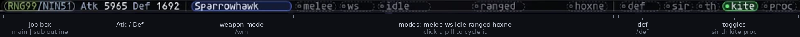
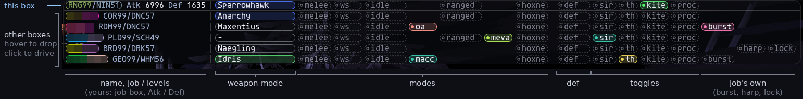

# Status bar and HUD

[← Back to the README](../README.md)

One window. The **bar** shows this box; hover it and every other box **drops in under it**, one line each (the
HUD). Click a line to drive that box.

- **Show:** `/gcbar` (or `DisplayBar = true`). `/gchud` turns the drop on, and the bar with it; `HUDOwners` boxes
  have it on at load.
- **Place:** centred at the top; with the drop on, at the right with room for the open drop (clear of status timers). Drag it
  anywhere (saved per character; within 8px of the top it snaps flush); `/gcbar reset` puts it back.
- **Size:** `/gcbar scale 0.5`–`3` (text and pills; saved per character).
- **Sync:** each box shares its modes when they change (checked 4x/s); the box with the drop reads them twice a
  second (`luashitacast/hud/`).

**A line**, left to right:

| Part | Shows |
|---|---|
| Job / name | Yours: job box (main \| sub outline), `Atk` `Def`. Others: name (first half of the letters in the main job's colour, the rest the sub's) and job/levels |
| Weapon | the weapon mode, coloured by its weapon (below); `+` = a slot pick (`/mw` `/sw` `/rw` `/ammoset`) changed |
| Modes | `melee` `ws` `idle` `nuke` `tank` `pup` `hoxne`...; blank = that job has no such mode |
| `def`, toggles | `def` (DT / MDT / Aminon), `sir` `th` `kite` `proc`, the job's own (`burst`, `harp`, `lock`...) |

- **Pills:** set or on = coloured outline, tint and dot, showing the value (`acc`, `mp`, `dt`); default or off =
  dashed grey and a ring, showing its name (`melee`, `idle`, `sir`).
- **Colours** follow goomui's colour preset for this character when goomui is installed (same 30 presets, by meaning:
  MP blue for `mp`/`mdt`, HP green for `hp`, TP for `tp`...); job and weapon colours stay. `Theme = 'ocean'` in
  char.lua picks one, `'goomswap'` keeps GoomSwap's own; `/gcbar theme [name]` tries one until reload. `/gcedit`
  has its own (its Theme button; same as the bar until you pick one).
- **Click** a pill: cycles it on that box (ctrl+click the weapon: `/mset`). **Right-click** a line's weapon pill:
  that box's weapon modes and Main/Sub/Range/Ammo picks, side by side; any other mode pill: its values. Click one and
  that box takes it. The drop stays open while a menu is. **Hover** a pill: its full value and what each click does.
- **Fixed width:** each column as wide as its widest value, `Atk`/`Def` as 4 digits; cycling never moves anything.
- **Your columns first:** the bar is only as wide as your line; columns only the other boxes have (a mage's `nuke`, a
  BRD's `harp`) sit after a divider and show with the drop. Opening it never moves your pills.
- A job without weapon modes (WHM...) shows `melee` `ws` `hoxne` only once changed.

<b>Pill colours</b>

| Pill | Colours |
|---|---|
| melee | `acc` cyan, `sb` magenta (a job's own modes: lime, salmon, periwinkle) |
| ws / idle | `high` purple / `mp` blue, `hp` green, `tp` yellow |
| nuke | `macc` teal, `oa` salmon |
| tank / hoxne | `main` periwinkle, `meva` lime / bronze |
| def | `dt` orange, `mdt` blue, `amin` mauve (`+` = more than one) |
| toggles | `sir` teal, `th` gold, `kite` green, `proc` red, `burst` pink |
| weapon | relic light blue, mythic and ergon green, empyrean red, prime purple, aeonic orange, TP bonus (Sparrowhawk +2, Anarchy +2) dark blue, others grey |

The weapon's class comes from the mode's Main, else Range, else Sub; add your own with
`WeaponClass = { ['Item Name'] = 'tpbonus' }`. Each of the 22 jobs has its own colour.

- **Drop:** opens on hover; in the screen's bottom half the lines rise above the bar. The box with it on also prints
  the other boxes' chat lines as `[Name]`.
- `/gchud debug` lists what it reads.
